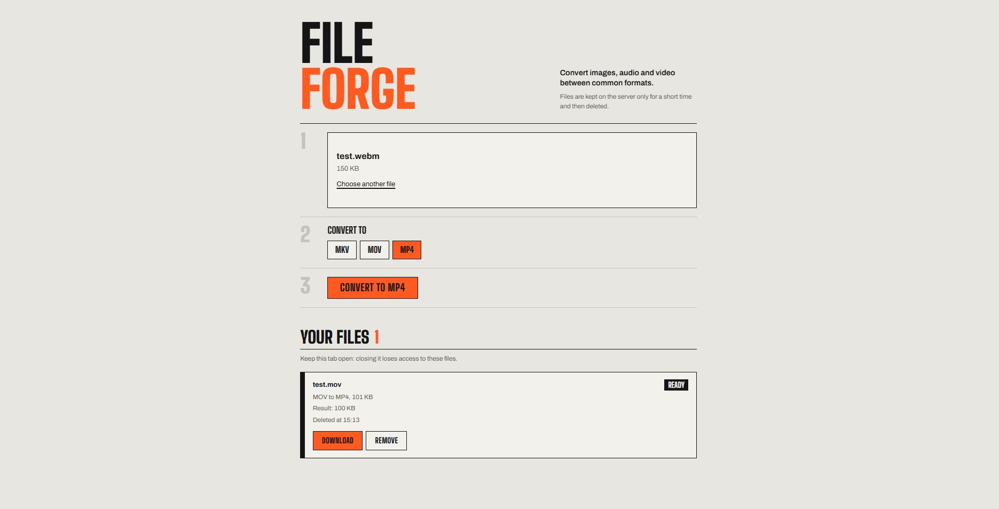
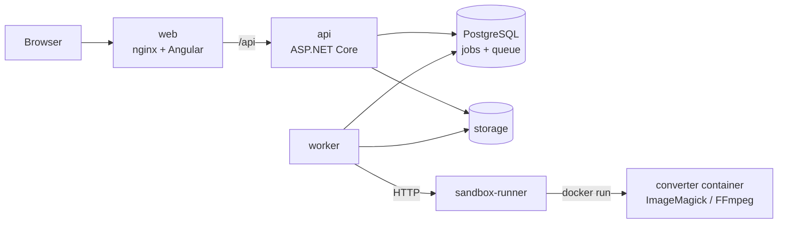

# FileForge

[](https://dotnet.microsoft.com)
[](https://www.postgresql.org)
[](https://angular.dev)
[](https://nginx.org)
[](https://docs.docker.com/compose/)
[](https://imagemagick.org)
[](https://ffmpeg.org)

**English** · [Русский](README.ru.md)

A web service that converts images, audio and video. You upload a file, choose the target format,
watch the progress and download the result. Every conversion runs in a short-lived Docker container
with no network and strict resource limits.



## Features

- **13 formats** in three groups. Conversion is possible within a group:

  | Group | Formats                  | Tool        |
  | ----- | ------------------------ | ----------- |
  | Image | JPG, PNG, WebP, BMP      | ImageMagick |
  | Audio | MP3, WAV, FLAC, OGG, AAC | FFmpeg      |
  | Video | MP4, MOV, MKV, WebM      | FFmpeg      |

- **Asynchronous jobs.** The API stores the upload and answers at once; a background worker converts
  it. Jobs can be cancelled while they are queued or running.
- **The format is detected by file content**, not by the extension.
- **Access by token, no accounts.** Each job gets its own secret token. Without it the job cannot be
  read, downloaded or deleted.
- **Automatic cleanup.** Results are deleted after one hour; stuck jobs are retried up to three times.
- **Web UI** in Angular with upload progress, live status and download.

## Architecture



1. **api** validates the upload (size, detected format, supported route), saves the file and creates
   a `Pending` job.
2. **worker** takes the next job from a PostgreSQL queue (`FOR UPDATE SKIP LOCKED`) and asks the
   **sandbox-runner** to convert it.
3. **sandbox-runner** is the only service with access to Docker. It starts a converter container
   with `--network none`, a read-only file system, a non-root user, dropped capabilities and memory,
   CPU, process and time limits.
4. The client polls the status and downloads the result.

The backend follows a layered structure: `Domain` → `Application` → `Infrastructure`, with `Api`,
`Worker` and `SandboxRunner` as entry points. Design decisions and known limitations are described in
[docs/decisions.md](docs/decisions.md).

## Quick start

Requires **Docker** with Docker Compose (Docker Desktop on Windows and macOS).

```bash
git clone https://github.com/kiraping1337/FileForge.git
cd FileForge
cp .env.example .env          # then set your own POSTGRES_PASSWORD
docker compose up --build
```

Open <http://localhost:8080>. The first build takes a few minutes.

To stop: `docker compose down`. Data is kept in Docker volumes; `docker compose down -v` deletes it.

### Settings (`.env`)

| Variable            | Default     | Meaning                                      |
| ------------------- | ----------- | -------------------------------------------- |
| `POSTGRES_PASSWORD` | —           | Database password, required                  |
| `POSTGRES_PORT`     | `5433`      | Database port on this computer (for pgAdmin) |
| `WEB_BIND`          | `127.0.0.1` | `0.0.0.0` opens the UI to the local network  |
| `WEB_PORT`          | `8080`      | Port of the web UI                           |

Limits (file size, retention time, timeouts) are set in the `appsettings.json` files of the
services and can be overridden with environment variables, for example
`Conversions__MaxFileSizeBytes`. To allow files above 200 MB, also raise `client_max_body_size` in
`frontend/nginx.conf`.

## API

Base path: `/api/v1`. Errors are returned as [ProblemDetails](https://www.rfc-editor.org/rfc/rfc9457)
with an extra `code` field, such as `FILE_TOO_LARGE` or `CONVERSION_NOT_SUPPORTED`.

| Method   | Path                         | Description                                                   |
| -------- | ---------------------------- | ------------------------------------------------------------- |
| `GET`    | `/formats`                   | Supported source formats and their targets                    |
| `POST`   | `/conversions`               | Upload a file (`multipart/form-data`: `file`, `targetFormat`) |
| `GET`    | `/conversions/{id}`          | Job status                                                    |
| `GET`    | `/conversions/{id}/download` | Download the result                                           |
| `DELETE` | `/conversions/{id}`          | Cancel or delete the job                                      |

`POST` returns `202 Accepted` with `jobId` and `accessToken`. All other job requests need the token
in the `X-Job-Token` header:

```bash
curl -F "file=@photo.png" -F "targetFormat=webp" http://localhost:8080/api/v1/conversions
curl -H "X-Job-Token: <accessToken>" http://localhost:8080/api/v1/conversions/<jobId>
curl -H "X-Job-Token: <accessToken>" -o photo.webp \
     http://localhost:8080/api/v1/conversions/<jobId>/download
```

## Development

Requires the **.NET 10 SDK**, **Node.js 24** and **Docker**.

```bash
# Database and converter images from Compose
docker compose up -d postgres
docker compose build imagemagick-image ffmpeg-image

# Backend: apply migrations, then run the API and the worker (in two terminals)
dotnet run --project src/FileForge.Api -- --migrate
dotnet run --project src/FileForge.Api
dotnet run --project src/FileForge.Worker

# Frontend: the dev server proxies /api to the API
cd frontend
npm install
npm start
```

When run like this, the worker starts the converter containers itself, without the sandbox runner.
The connection string is `ConnectionStrings:Postgres`.

### Tests

```bash
dotnet test
```

- **Unit tests**: domain rules, tokens, format detection, storage, converter arguments.
- **Integration tests**: the full HTTP flow against a real PostgreSQL started by
  [Testcontainers](https://dotnet.testcontainers.org/). Docker must be running.

## Project structure

```text
src/
  FileForge.Domain/          Entities and their rules (job states, files, tokens)
  FileForge.Application/     Use cases and interfaces (create, get, download, delete, cleanup)
  FileForge.Infrastructure/  EF Core, PostgreSQL queue, file storage, Docker sandbox, converters
  FileForge.Api/             REST API
  FileForge.Worker/          Background conversion and cleanup
  FileForge.SandboxRunner/   The only service with access to Docker
tests/                       Unit and integration tests
frontend/                    Angular app and nginx configuration
converters/                  Docker images of ImageMagick and FFmpeg
deploy/                      Dockerfile for the backend services
docs/                        Design decisions
```

## Tech stack

.NET 10, ASP.NET Core, EF Core, PostgreSQL 17, Angular, nginx, Docker Compose, ImageMagick, FFmpeg,
xUnit, Testcontainers.

Third-party components and their licenses are listed in
[THIRD_PARTY_NOTICES.md](THIRD_PARTY_NOTICES.md).

## License

[MIT](LICENSE)
