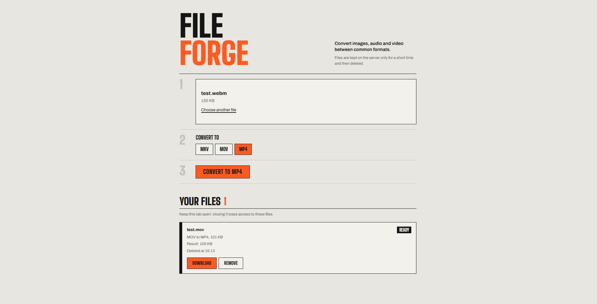
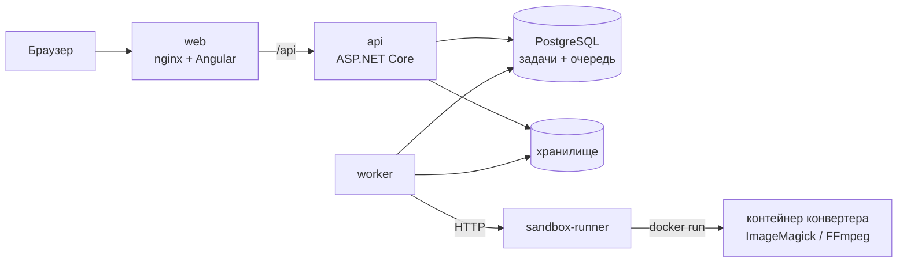

# FileForge

[](https://dotnet.microsoft.com)
[](https://www.postgresql.org)
[](https://angular.dev)
[](https://nginx.org)
[](https://docs.docker.com/compose/)
[](https://imagemagick.org)
[](https://ffmpeg.org)

[English](README.md) · **Русский**

Веб-сервис для конвертации изображений, аудио и видео. Загрузите файл, выберите целевой формат,
следите за ходом конвертации и скачивайте результат. Каждая конвертация выполняется в отдельном
одноразовом Docker-контейнере без доступа к сети и с жёсткими лимитами ресурсов.



## Возможности

- **13 форматов** в трёх группах. Конвертация возможна внутри группы:

  | Группа      | Форматы                  | Инструмент  |
  | ----------- | ------------------------ | ----------- |
  | Изображения | JPG, PNG, WebP, BMP      | ImageMagick |
  | Аудио       | MP3, WAV, FLAC, OGG, AAC | FFmpeg      |
  | Видео       | MP4, MOV, MKV, WebM      | FFmpeg      |

- **Асинхронная обработка.** API сохраняет загруженный файл и сразу возвращает ответ; конвертацией
  занимается фоновый воркер. Задачу можно отменить, пока она в очереди или выполняется.
- **Формат определяется по содержимому файла**, а не по расширению.
- **Доступ по токену, без регистрации.** У каждой задачи свой секретный токен. Без него задачу
  нельзя прочитать, скачать или удалить.
- **Автоматическая очистка.** Результаты удаляются через час; зависшие задачи перезапускаются, но не
  более трёх раз.
- **Веб-интерфейс** на Angular: прогресс загрузки, статус в реальном времени, скачивание.

## Архитектура



1. **api** проверяет загрузку (размер, определённый формат, поддерживаемое направление), сохраняет
   файл и создаёт задачу в статусе `Pending`.
2. **worker** берёт следующую задачу из очереди PostgreSQL (`FOR UPDATE SKIP LOCKED`) и передаёт её
   **sandbox-runner** на конвертацию.
3. **sandbox-runner** - единственный сервис с доступом к Docker. Он запускает контейнер конвертера
   с `--network none`, файловой системой только для чтения, непривилегированным пользователем,
   без capabilities и с лимитами на память, CPU, число процессов и время работы.
4. Клиент опрашивает статус и скачивает результат.

Бэкенд разделён на слои: `Domain` → `Application` → `Infrastructure`; точки входа - `Api`, `Worker`
и `SandboxRunner`. Архитектурные решения и известные ограничения описаны в
[docs/decisions.md](docs/decisions.md) (на английском).

## Быстрый старт

Требуется **Docker** с Docker Compose (на Windows и macOS - Docker Desktop).

```bash
git clone https://github.com/kiraping1337/FileForge.git
cd FileForge
cp .env.example .env          # затем укажите свой POSTGRES_PASSWORD
docker compose up --build
```

Откройте <http://localhost:8080>. Первая сборка занимает несколько минут.

Остановить сервисы: `docker compose down`. Данные хранятся в Docker-томах; команда
`docker compose down -v` удаляет их.

### Настройки (`.env`)

| Переменная          | По умолчанию | Назначение                                       |
| ------------------- | ------------ | ------------------------------------------------ |
| `POSTGRES_PASSWORD` | -            | Пароль базы данных, обязателен                   |
| `POSTGRES_PORT`     | `5433`       | Порт базы на этой машине (для pgAdmin)           |
| `WEB_BIND`          | `127.0.0.1`  | `0.0.0.0` открывает интерфейс для локальной сети |
| `WEB_PORT`          | `8080`       | Порт веб-интерфейса                              |

Лимиты (размер файла, время хранения, таймауты) задаются в `appsettings.json` сервисов и могут
быть переопределены переменными окружения, например `Conversions__MaxFileSizeBytes`. Чтобы
разрешить файлы больше 200 МБ, нужно также увеличить `client_max_body_size` в
`frontend/nginx.conf`.

## API

Базовый путь: `/api/v1`. Ошибки возвращаются в формате
[ProblemDetails](https://www.rfc-editor.org/rfc/rfc9457) с дополнительным полем `code`, например
`FILE_TOO_LARGE` или `CONVERSION_NOT_SUPPORTED`.

| Метод    | Путь                         | Описание                                                       |
| -------- | ---------------------------- | -------------------------------------------------------------- |
| `GET`    | `/formats`                   | Поддерживаемые исходные форматы и их цели                      |
| `POST`   | `/conversions`               | Загрузить файл (`multipart/form-data`: `file`, `targetFormat`) |
| `GET`    | `/conversions/{id}`          | Статус задачи                                                  |
| `GET`    | `/conversions/{id}/download` | Скачать результат                                              |
| `DELETE` | `/conversions/{id}`          | Отменить или удалить задачу                                    |

`POST` возвращает `202 Accepted` с `jobId` и `accessToken`. Остальные запросы к задаче требуют токен
в заголовке `X-Job-Token`:

```bash
curl -F "file=@photo.png" -F "targetFormat=webp" http://localhost:8080/api/v1/conversions
curl -H "X-Job-Token: <accessToken>" http://localhost:8080/api/v1/conversions/<jobId>
curl -H "X-Job-Token: <accessToken>" -o photo.webp \
     http://localhost:8080/api/v1/conversions/<jobId>/download
```

## Разработка

Требуются **.NET 10 SDK**, **Node.js 24** и **Docker**.

```bash
# База данных и образы конвертеров из Compose
docker compose up -d postgres
docker compose build imagemagick-image ffmpeg-image

# Бэкенд: применить миграции, затем запустить API и воркер (в двух терминалах)
dotnet run --project src/FileForge.Api -- --migrate
dotnet run --project src/FileForge.Api
dotnet run --project src/FileForge.Worker

# Фронтенд: dev-сервер проксирует /api на API
cd frontend
npm install
npm start
```

В таком режиме воркер сам запускает контейнеры конвертеров, без sandbox-runner.
Строка подключения - `ConnectionStrings:Postgres`.

### Тесты

```bash
dotnet test
```

- **Модульные тесты**: правила домена, токены, определение формата, хранилище, аргументы
  конвертеров.
- **Интеграционные тесты**: полный HTTP-сценарий на настоящем PostgreSQL, который поднимает
  [Testcontainers](https://dotnet.testcontainers.org/). Docker должен быть запущен.

## Структура проекта

```text
src/
  FileForge.Domain/          Сущности и их правила (статусы задач, файлы, токены)
  FileForge.Application/     Сценарии использования и интерфейсы (создание, статус, скачивание, удаление, очистка)
  FileForge.Infrastructure/  EF Core, очередь в PostgreSQL, файловое хранилище, Docker-песочница, конвертеры
  FileForge.Api/             REST API
  FileForge.Worker/          Фоновая конвертация и очистка
  FileForge.SandboxRunner/   Единственный сервис с доступом к Docker
tests/                       Модульные и интеграционные тесты
frontend/                    Angular-приложение и конфигурация nginx
converters/                  Docker-образы ImageMagick и FFmpeg
deploy/                      Dockerfile для сервисов бэкенда
docs/                        Архитектурные решения
```

## Технологии

.NET 10, ASP.NET Core, EF Core, PostgreSQL 17, Angular, nginx, Docker Compose, ImageMagick, FFmpeg,
xUnit, Testcontainers.

Сторонние компоненты и их лицензии перечислены в [THIRD_PARTY_NOTICES.md](THIRD_PARTY_NOTICES.md).

## Лицензия

[MIT](LICENSE.txt)
